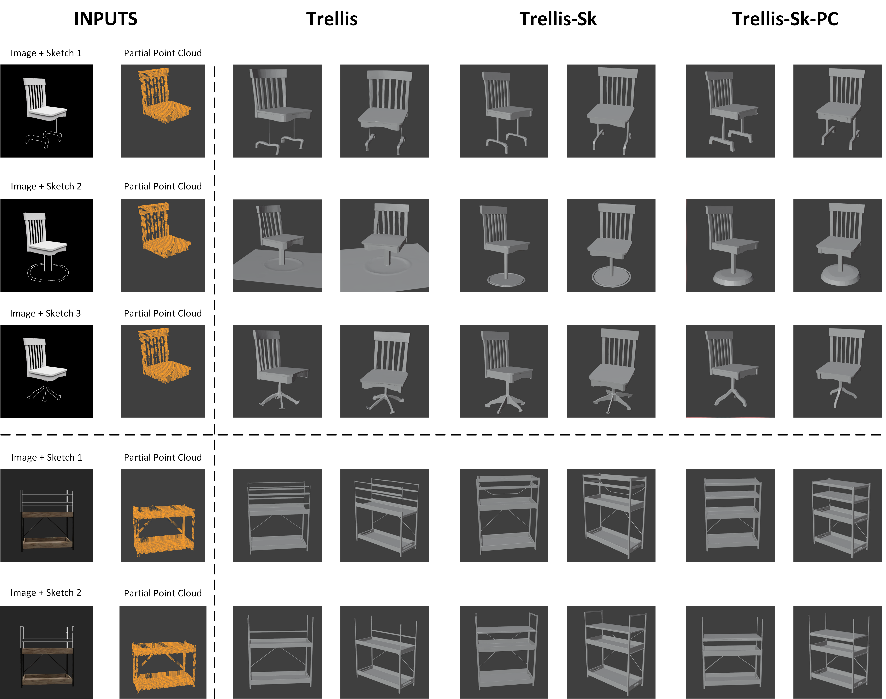

<h1 align="center">Structure Aware 3D Inpainting:<br> Guided Reconstruction with Point Cloud Masks and Sketch Prompts</h1>

<p align="center"></p>

## 🚀 Overview

This repository provides an extension and update built upon [TRELLIS](https://microsoft.github.io/TRELLIS/), adapting its rectified flow foundation for guided 3D structure inpainting.

While recent advancements in 3D generative modeling have accelerated asset synthesis, modifying or completing existing geometries remains a challenge. Our approach introduces a novel framework for partial 3D inpainting using:

- Partial Point-Cloud Masks: Define specific structural bounding and spatial constraints.

- Image-Sketch Pairs: Provide intuitive, fine-grained control for guided structural updates.

Our evaluations demonstrate that leveraging existing structural components  improves reconstruction accuracy over full asset generation, while offering precise, sketch-driven manipulation.


<!-- Features -->
## 🌟 Features
- **High Quality**: It produces diverse 3D assets at high quality with intricate shape and texture details.
- **Versatility**: It takes image and partial point cloud prompts and can generate various final 3D representations including but not limited to *Radiance Fields*, *3D Gaussians*, and *meshes*, accommodating diverse downstream requirements.
- **Flexible Editing**: It allows for easy editings of generated 3D assets, such as generating variants of the same object or local editing of the 3D asset.

<!-- Installation -->
## 📦 Installation

Installation requirements are largely inherited from the original TRELLIS project. Follow the base environment setup below, along with any additional dependencies required for our inpainting and sketch-conditioning modules

### Prerequisites
- **System**: The code is currently tested only on **Linux**.
- **Hardware**: An NVIDIA GPU with at least 18GB of memory is necessary.
- **Software**:   
  - The [CUDA Toolkit](https://developer.nvidia.com/cuda-toolkit-archive) is needed to compile certain submodules. The code has been tested with CUDA versions 11.8 and 12.2.  
  - [Conda](https://docs.anaconda.com/miniconda/install/#quick-command-line-install) is recommended for managing dependencies.  
  - Python version 3.8 or higher is required. 

### Installation Steps
1. Clone the repo:
    ```sh
    git clone --recurse-submodules https://github.com/ArminasSid/trellis-inpaint.git
    cd trellis-inpaint
    ```

2. Install the dependencies:
    
    **Before running the following command there are somethings to note:**
    - By adding `--new-env`, a new conda environment named `trellis-inpaint` will be created. If you want to use an existing conda environment, please remove this flag.
    - By default the `trellis-inpaint` environment will use pytorch 2.4.0 with CUDA 11.8. If you want to use a different version of CUDA (e.g., if you have CUDA Toolkit 12.2 installed and do not want to install another 11.8 version for submodule compilation), you can remove the `--new-env` flag and manually install the required dependencies. Refer to [PyTorch](https://pytorch.org/get-started/previous-versions/) for the installation command.
    - If you have multiple CUDA Toolkit versions installed, `PATH` should be set to the correct version before running the command. For example, if you have CUDA Toolkit 11.8 and 12.2 installed, you should run `export PATH=/usr/local/cuda-11.8/bin:$PATH` before running the command.
    - The installation may take a while due to the large number of dependencies. Please be patient. If you encounter any issues, you can try to install the dependencies one by one, specifying one flag at a time.
    
    Create a new conda environment named `trellis-inpaint` and install the dependencies:
    ```sh
    . ./setup.sh --new-env --basic --xformers --flash-attn --diffoctreerast --spconv --mipgaussian --kaolin --nvdiffrast
    ```
    The detailed usage of `setup.sh` can be found by running `. ./setup.sh --help`.
    ```sh
    Usage: setup.sh [OPTIONS]
    Options:
        -h, --help              Display this help message
        --new-env               Create a new conda environment
        --basic                 Install basic dependencies
        --train                 Install training dependencies
        --xformers              Install xformers
        --flash-attn            Install flash-attn
        --diffoctreerast        Install diffoctreerast
        --spconv                Install spconv
        --mipgaussian           Install mip-splatting
        --kaolin                Install kaolin
        --nvdiffrast            Install nvdiffrast
        --demo                  Install all dependencies for demo
    ```

<!-- Pretrained Models -->
## 🤖 Pretrained Models

We recommend using a pre-trained TRELLIS image model from the original repo for further fine-tuning.

| Model | Description | #Params | Download |
| --- | --- | --- | --- |
| TRELLIS-image-large | Large image-to-3D model | 1.2B | [Download](https://huggingface.co/microsoft/TRELLIS-image-large) |

*Note: It is always recommended to use the image conditioned version of the models for better performance.*

*Note: All VAEs are included in **TRELLIS-image-large** model repo.*

The models are hosted on Hugging Face. You can directly load the models with their repository names in the code:
```python
TrellisImageTo3DPipeline.from_pretrained("microsoft/TRELLIS-image-large")
```

If you prefer loading the model from local, you can download the model files from the links above and load the model with the folder path (folder structure should be maintained):
```python
TrellisImageTo3DPipeline.from_pretrained("/path/to/TRELLIS-image-large")
```

<!-- Usage -->
## 💡 Usage

### Minimal Example

Here is an [example](example_inpaint.py) of how to use the pretrained models for 3D asset generation.

```python
import os
# os.environ['ATTN_BACKEND'] = 'xformers'   # Can be 'flash-attn' or 'xformers', default is 'flash-attn'
os.environ['SPCONV_ALGO'] = 'native'        # Can be 'native' or 'auto', default is 'auto'.
                                            # 'auto' is faster but will do benchmarking at the beginning.
                                            # Recommended to set to 'native' if run only once.

import imageio
from PIL import Image
from trellis.pipelines import TrellisImageTo3DPipeline
from trellis.utils import render_utils, postprocessing_utils

# ...
# Various utility functions for loading in point clouds
# ...

# Load a pipeline from a model folder
pipeline = TrellisImageTo3DPipeline.from_pretrained("./models/image-large-pc")
pipeline.cuda()

# Load an image
# Could use a different full render for materials.
image_render = Image.open("./assets/example_inpaint/var_1_1.png") 

image = Image.open("./assets/example_inpaint/var_1_1.png")


voxels_path = "./assets/example_inpaint/voxel_partial_var_1.ply"
latent_dmg = encode_voxels(get_voxels(voxels_path))
print(latent_dmg.shape)

latent_mask = get_latent_mask(voxels_path)

output_name = 'sample_1'

save_normalized_ply(voxels_path, f'./{output_name}_gt.ply')


# Run the pipeline
outputs = pipeline.run_inpaint(
    image_render,
    image,
    latent_dmg,
    latent_mask,
    seed=1,
    # Optional parameters
    sparse_structure_sampler_params={
        "steps": 30,
        "cfg_strength": 5
    },
    slat_sampler_params={
        "steps": 10,
        "cfg_strength": 3,
    }
)
# outputs is a dictionary containing generated 3D assets in different formats:
# - outputs['gaussian']: a list of 3D Gaussians
# - outputs['radiance_field']: a list of radiance fields
# - outputs['mesh']: a list of meshes

# Render the outputs
video = render_utils.render_video(outputs['gaussian'][0])['color']
imageio.mimsave(f"{output_name}_gs.mp4", video, fps=30)
video = render_utils.render_video(outputs['radiance_field'][0])['color']
imageio.mimsave(f"{output_name}_rf.mp4", video, fps=30)
video = render_utils.render_video(outputs['mesh'][0])['normal']
imageio.mimsave(f"{output_name}_mesh.mp4", video, fps=30)

glb_struct = postprocessing_utils.to_glb(
    outputs['gaussian'][0],
    outputs['mesh'][0],
    simplify=0.95,
    texture_size=1024,
)
glb_struct.export(f"{output_name}_struct.glb")


glb_material = postprocessing_utils.to_glb(
    outputs['radiance_field'][0],
    outputs['mesh'][0],
    simplify=0.95,
    texture_size=1024,
    fill_holes=False
)

glb_material.export(f"{output_name}_material.glb")

# Save Gaussians as PLY files
outputs['gaussian'][0].save_ply(f"{output_name}.ply")
```

After running the code, you will get the following files:
- `sample_1_mesh.mp4`: a video showing the mesh representation
- `sample_1.glb`: a GLB file containing the extracted textured mesh
- `sample_1.ply`: a PLY file containing the 3D Gaussian representation

<!-- Dataset -->
## 📚 Dataset

Currently, only the HSSD dataset is provided from the original repository. Additional dataset parsing and preparation tools will be added in future updates. To generate the dataset, please refer to the [dataset README](DATASET.md) for more details.


<!-- Training -->
## 🏋️‍♂️ Training

Base training workflows and scripts are retained from the original [TRELLIS](https://github.com/microsoft/TRELLIS) repository.

> **Note on Inpainting Fine-tuning:** 
> To train or fine-tune the model with our partial point-cloud masks and sketch conditioning, ensure your dataset is prepared according to `DATASET.md` and use the updated training configuration file (`configs/generation/ss_flow_img_dit_L_16l8_fp16.json`)

The training code is centered around `train.py` and is structured into several directories to clearly separate dataset handling, model components, training logic, and visualization utilities.

### Code Structure

- **train.py**: Main entry point for training.
- **trellis/datasets**: Dataset loading and preprocessing.
- **trellis/models**: Different models and their components.
- **trellis/modules**: Custom modules for various models.
- **trellis/pipelines**: Inference pipelines for different models.
- **trellis/renderers**: Renderers for different 3D representations.
- **trellis/representations**: Different 3D representations.
- **trellis/trainers**: Training logic for different models.
- **trellis/utils**: Utility functions for training and visualization.

### Training Setup

1. **Prepare the Environment:**
   - Ensure all training dependencies are installed.
   - Use a Linux system with an NVIDIA GPU (The models are trained on NVIDIA A100 GPUs).
   - For distributed training, verify that your nodes can communicate through the designated master address and port.

2. **Dataset Preparation:**
   - Organize your dataset similar to TRELLIS-500K. Specify your dataset path using the `--data_dir` argument when launching training.

3. **Configuration Files:**
   - Training hyperparameters and model architectures are defined in configuration files under the `configs/` directory.
   - Example configuration files include:

| Config | Pretained Model | Description |
| --- | --- | --- |
| [`vae/ss_vae_conv3d_16l8_fp16.json`](configs/vae/ss_vae_conv3d_16l8_fp16.json) | [Encoder](https://huggingface.co/microsoft/TRELLIS-image-large/blob/main/ckpts/ss_enc_conv3d_16l8_fp16.safetensors) [Decoder](https://huggingface.co/microsoft/TRELLIS-image-large/blob/main/ckpts/ss_dec_conv3d_16l8_fp16.safetensors) | Sparse structure VAE |
| [`vae/slat_vae_enc_dec_gs_swin8_B_64l8_fp16.json`](configs/vae/slat_vae_enc_dec_gs_swin8_B_64l8_fp16.json) | [Encoder](https://huggingface.co/microsoft/TRELLIS-image-large/blob/main/ckpts/slat_enc_swin8_B_64l8_fp16.safetensors) [Decoder](https://huggingface.co/microsoft/TRELLIS-image-large/blob/main/ckpts/slat_dec_gs_swin8_B_64l8gs32_fp16.safetensors) | SLat VAE with Gaussian Decoder |
| [`vae/slat_vae_dec_rf_swin8_B_64l8_fp16.json`](configs/vae/slat_vae_dec_rf_swin8_B_64l8_fp16.json) | [Decoder](https://huggingface.co/microsoft/TRELLIS-image-large/blob/main/ckpts/slat_dec_rf_swin8_B_64l8r16_fp16.safetensors) | SLat Radiance Field Decoder |
| [`vae/slat_vae_dec_mesh_swin8_B_64l8_fp16.json`](configs/vae/slat_vae_dec_mesh_swin8_B_64l8_fp16.json) | [Decoder](https://huggingface.co/microsoft/TRELLIS-image-large/blob/main/ckpts/slat_dec_mesh_swin8_B_64l8m256c_fp16.safetensors) | SLat Mesh Decoder |
| [`generation/ss_flow_img_dit_L_16l8_fp16.json`](configs/generation/ss_flow_img_dit_L_16l8_fp16.json) | [Denoiser](https://huggingface.co/microsoft/TRELLIS-image-large/blob/main/ckpts/ss_flow_img_dit_L_16l8_fp16.safetensors) | Image conditioned sparse structure Flow Model |
| [`generation/slat_flow_img_dit_L_64l8p2_fp16.json`](configs/generation/slat_flow_img_dit_L_64l8p2_fp16.json) | [Denoiser](https://huggingface.co/microsoft/TRELLIS-image-large/blob/main/ckpts/slat_flow_img_dit_L_64l8p2_fp16.safetensors) | Image conditioned SLat Flow Model |

### Command-Line Options

The training script can be run as follows:
```sh
usage: train.py [-h] --config CONFIG --output_dir OUTPUT_DIR [--load_dir LOAD_DIR] [--ckpt CKPT] [--data_dir DATA_DIR] [--auto_retry AUTO_RETRY] [--tryrun] [--profile] [--num_nodes NUM_NODES] [--node_rank NODE_RANK] [--num_gpus NUM_GPUS] [--master_addr MASTER_ADDR] [--master_port MASTER_PORT]

options:
  -h, --help                    show this help message and exit
  --config CONFIG               Experiment config file
  --output_dir OUTPUT_DIR       Output directory
  --load_dir LOAD_DIR           Load directory, default to output_dir
  --ckpt CKPT                   Checkpoint step to resume training, default to latest
  --data_dir DATA_DIR           Data directory
  --auto_retry AUTO_RETRY       Number of retries on error
  --tryrun                      Try run without training
  --profile                     Profile training
  --num_nodes NUM_NODES         Number of nodes
  --node_rank NODE_RANK         Node rank
  --num_gpus NUM_GPUS           Number of GPUs per node, default to all
  --master_addr MASTER_ADDR     Master address for distributed training
  --master_port MASTER_PORT     Port for distributed training
```

### Example Training Commands

To train a image-to-3D stage 2 model with a single machine.
```sh
python train.py \
  --config configs/vae/slat_vae_dec_mesh_swin8_B_64l8_fp16.json \
  --output_dir outputs/slat_vae_dec_mesh_swin8_B_64l8_fp16_1node \
  --data_dir /path/to/your/dataset1,/path/to/your/dataset2 \
```
The script will automatically distribute the training across all available GPUs. Specify the number of GPUs with the `--num_gpus` flag if you want to limit the number of GPUs used.

### Additional Options

- **Auto Retry:** Use the `--auto_retry` flag to specify the number of retries in case of intermittent errors.
- **Dry Run:** The `--tryrun` flag allows you to check your configuration and environment without launching full training.
- **Profiling:** Enable profiling with the `--profile` flag to gain insights into training performance and diagnose bottlenecks.

Adjust the file paths and parameters to match your experimental setup.


<!-- License -->
## ⚖️ License

Licensed under the [MIT License](LICENSE).
